<picture>
  <source media="(prefers-color-scheme: dark)" srcset="assets/banner-dark.png">
  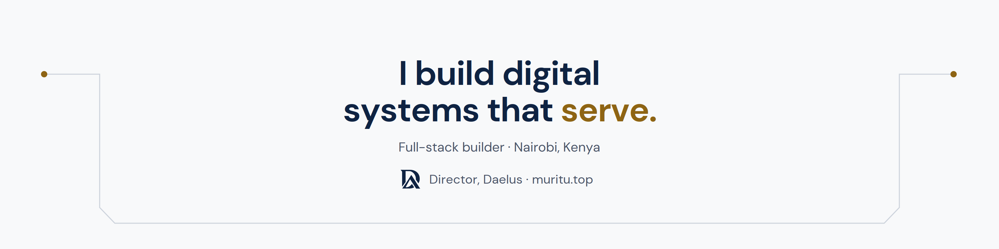
</picture>

I build software in Nairobi, mostly for things people here deal with every day: money, learning, farming and getting around. Right now I run **[Daelus](https://www.daelus.co.ke)**, a small software studio.

<table>
<tr>
<td width="50%"><a href="https://github.com/ken-muritu/rewind">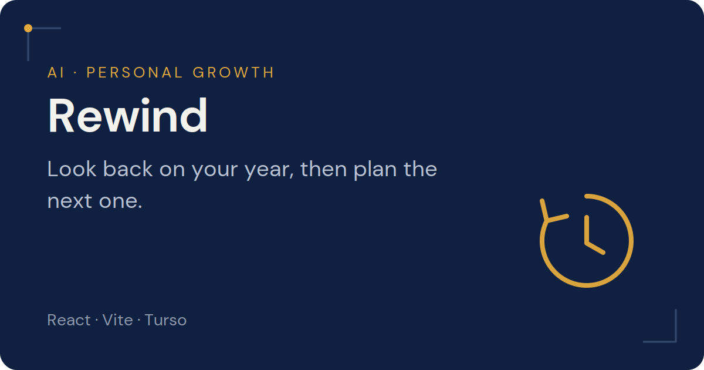</a> <a href="https://github.com/ken-muritu/rewind">Code</a> · <a href="https://rewindsite.vercel.app">Live</a></td>
<td width="50%"><a href="https://github.com/ken-muritu/luminary">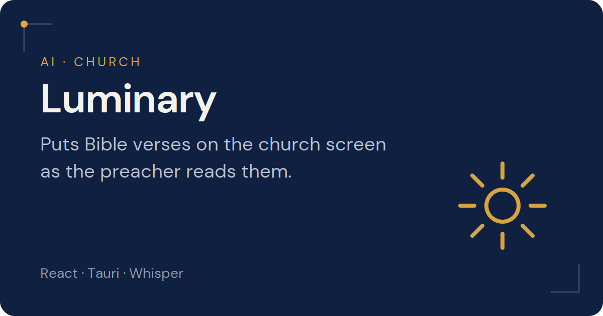</a> <a href="https://github.com/ken-muritu/luminary">Code</a> · <a href="https://luminarysite.vercel.app">Live</a></td>
</tr>
<tr>
<td width="50%"> <a href="https://github.com/ken-muritu/msingi">Code</a> · <a href="https://msingios.vercel.app">Live</a></td>
<td width="50%"><a href="https://github.com/ken-muritu/Fungu">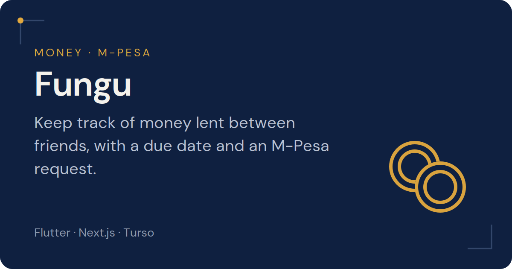</a> <a href="https://github.com/ken-muritu/Fungu">Code</a> · <a href="https://fungu-web.vercel.app">Live</a></td>
</tr>
<tr>
<td width="50%"><a href="https://github.com/ken-muritu/harvestly">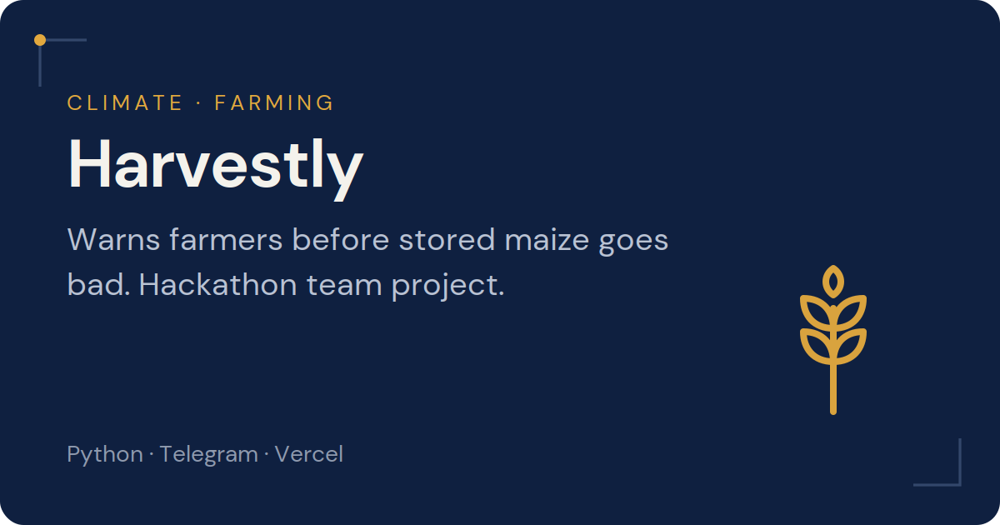</a> <a href="https://github.com/ken-muritu/harvestly">Code</a> · <a href="https://harvestly-roan.vercel.app">Live</a></td>
<td width="50%"><a href="https://github.com/ken-muritu/pesastudio">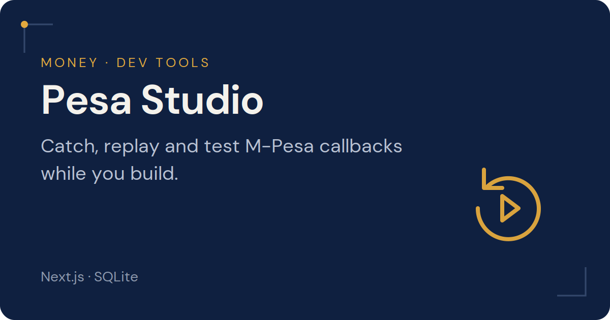</a> <a href="https://github.com/ken-muritu/pesastudio">Code</a> · <a href="https://pesastudio.vercel.app">Live</a></td>
</tr>
<tr>
<td width="50%"><a href="https://github.com/ken-muritu/primer">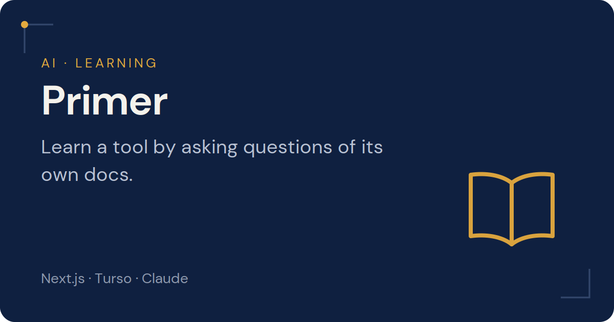</a> <a href="https://github.com/ken-muritu/primer">Code</a> · <a href="https://primer-puce.vercel.app">Live</a></td>
<td width="50%"><a href="https://github.com/ken-muritu/aurum">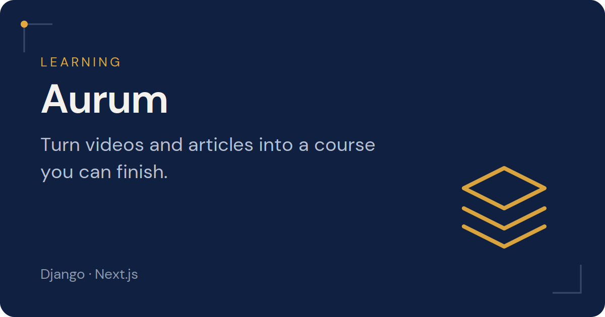</a> <a href="https://github.com/ken-muritu/aurum">Code</a> · <a href="https://aurumio.vercel.app">Live</a></td>
</tr>
<tr>
<td width="50%"><a href="https://github.com/ken-muritu/mat3">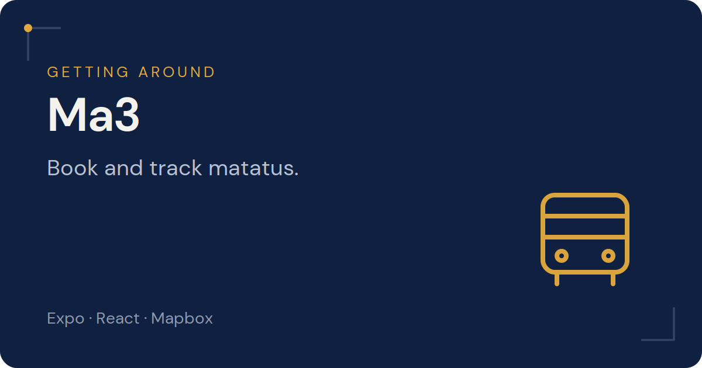</a> <a href="https://github.com/ken-muritu/mat3">Code</a> · <a href="https://mat-web.vercel.app">Live</a></td>
<td width="50%"><a href="https://github.com/ken-muritu/tafari">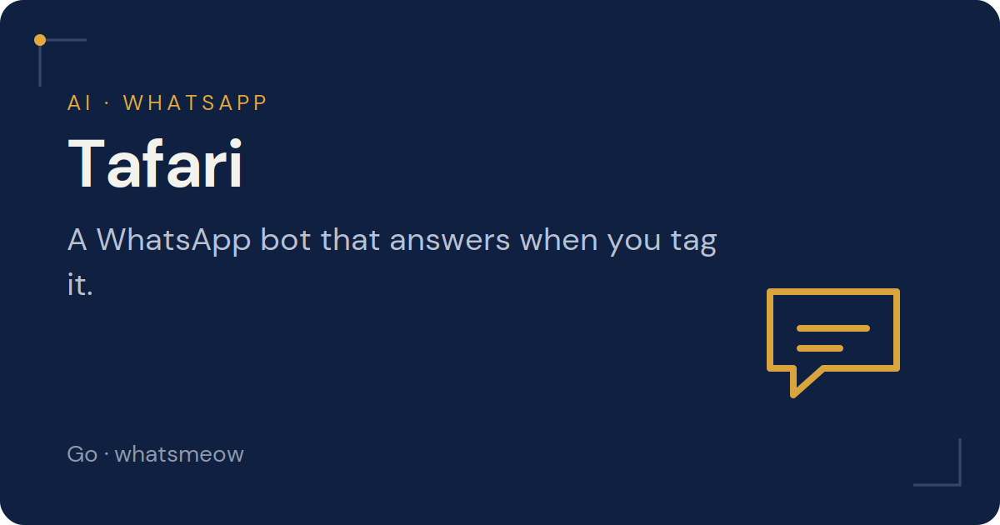</a> <a href="https://github.com/ken-muritu/tafari">Code</a></td>
</tr>
<tr>
<td width="50%"><a href="https://github.com/ken-muritu/frameflow">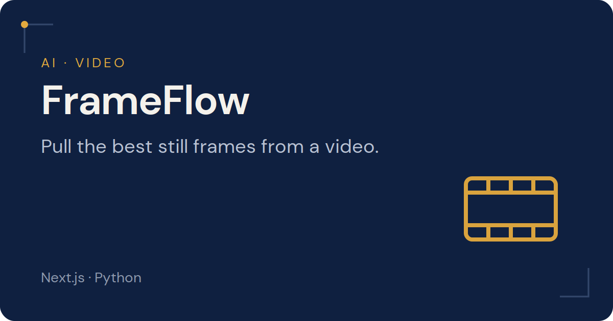</a> <a href="https://github.com/ken-muritu/frameflow">Code</a> · <a href="https://frameflow.vercel.app">Live</a></td>
<td width="50%"><a href="https://github.com/ken-muritu/foveo">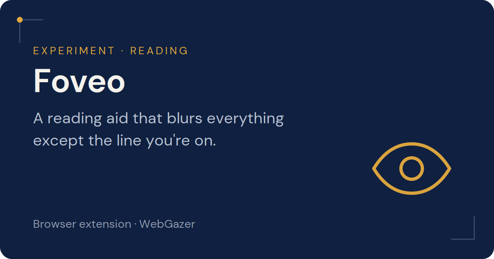</a> <a href="https://github.com/ken-muritu/foveo">Code</a></td>
</tr>
<tr>
<td width="50%"><a href="https://github.com/ken-muritu/vela">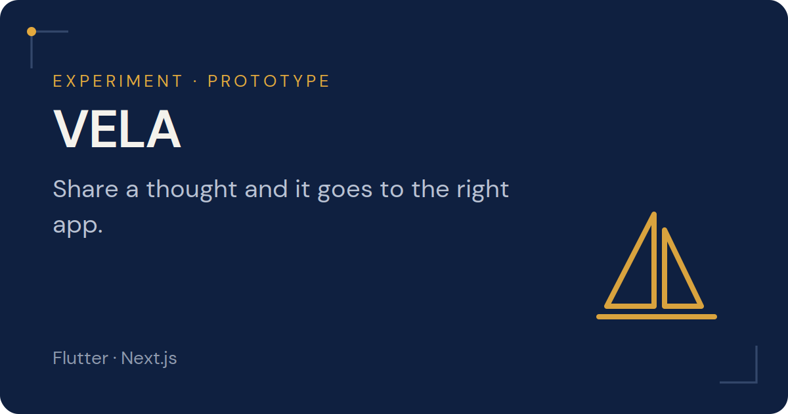</a> <a href="https://github.com/ken-muritu/vela">Code</a> · <a href="https://velaxyz.vercel.app">Live</a></td>
<td width="50%"><a href="https://github.com/ken-muritu/schedulepro">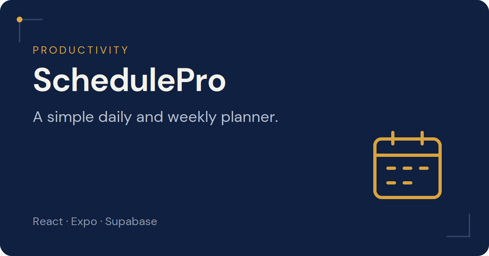</a> <a href="https://github.com/ken-muritu/schedulepro">Code</a> · <a href="https://schedulepro-web.vercel.app">Live</a></td>
</tr>
</table>

Mostly TypeScript, Python, Flutter and Go.

[muritu.top](https://www.muritu.top) · [X](https://x.com/muri_tuu) · [Instagram](https://www.instagram.com/muri_tuu)
